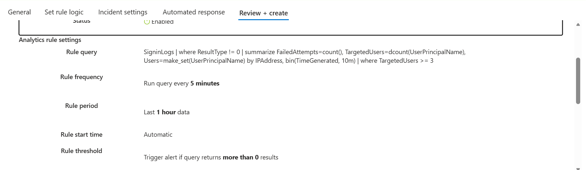
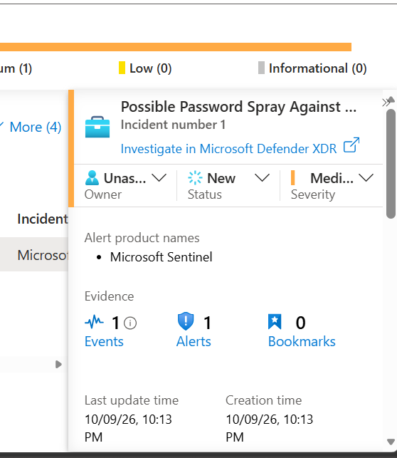
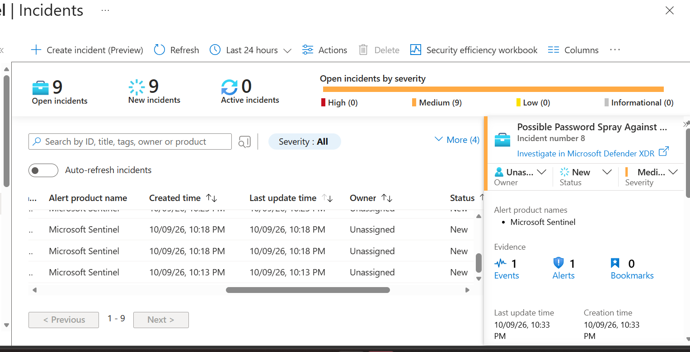
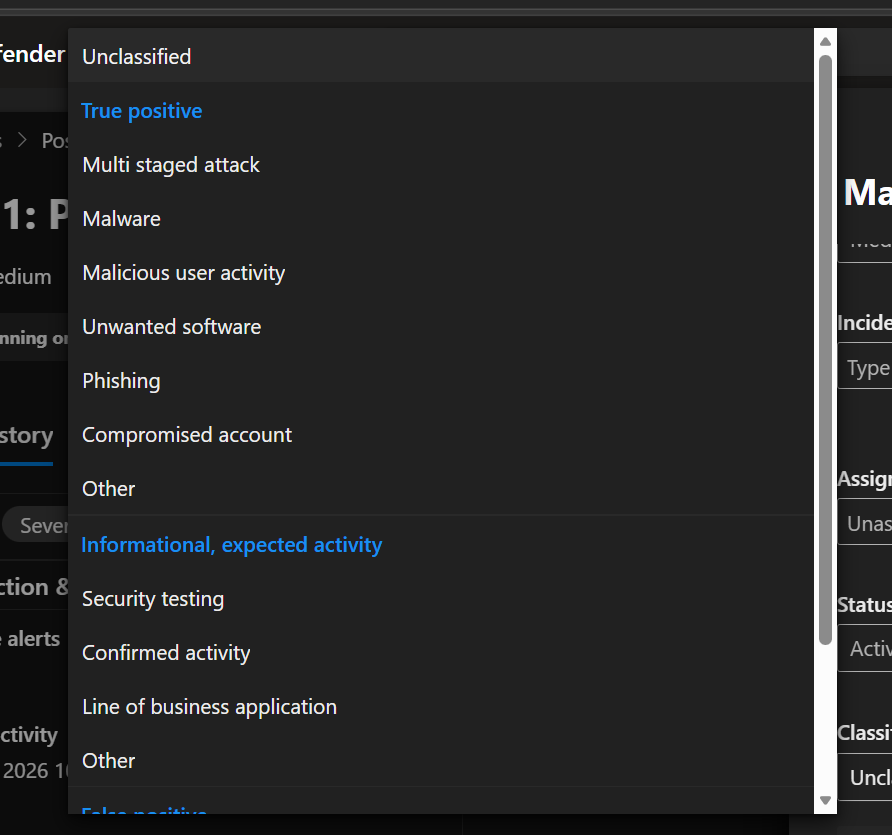

# Screenshot Evidence

Selected original screenshots were visually reviewed and contain no exposed email addresses, tenant/subscription IDs, or public IP addresses. They are copied without edits.

| File | What it supports | Limitation |
| --- | --- | --- |
| initial-rule-settings.png | Initial scheduled rule logic, frequency, lookback, and threshold | Earlier configuration: 5 minutes / 1 hour, not the final tuned configuration |
| sentinel-incident.png | Generated Medium Sentinel incident with one alert | Does not prove final classification |
| repeated-incidents.png | Multiple incidents visible before tuning | Does not measure the effect of tuning |
| classification-options.png | Security testing classification is available | Open menu; does not prove the choice was saved |

The results screenshot showing 8 failures, 7 users, and 0 successes was reviewed but omitted because it exposes the public source IP and account names. Other portal screenshots exposing subscription IDs or account information were also omitted. The latest tuned configuration is documented from the conversation's pasted summary.
